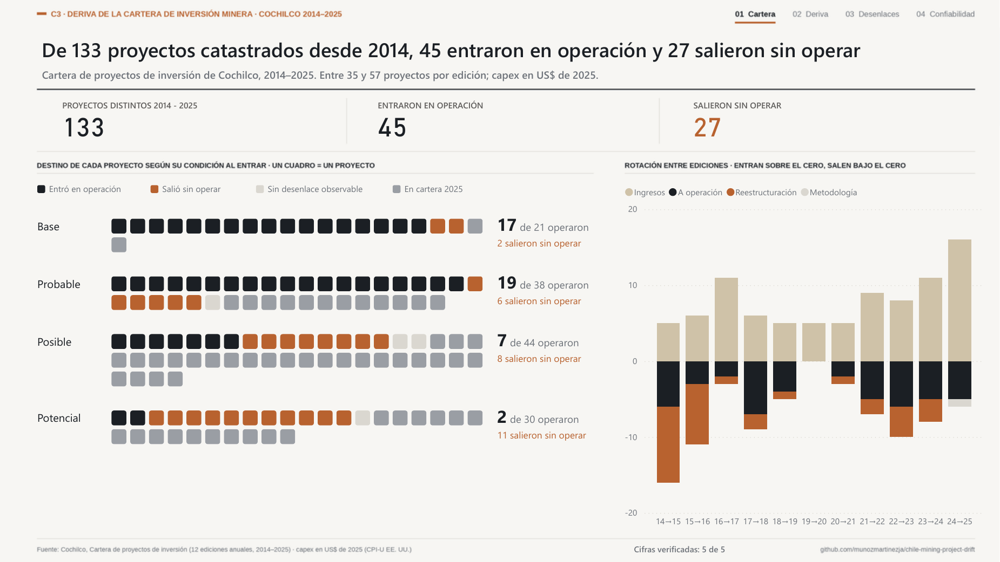
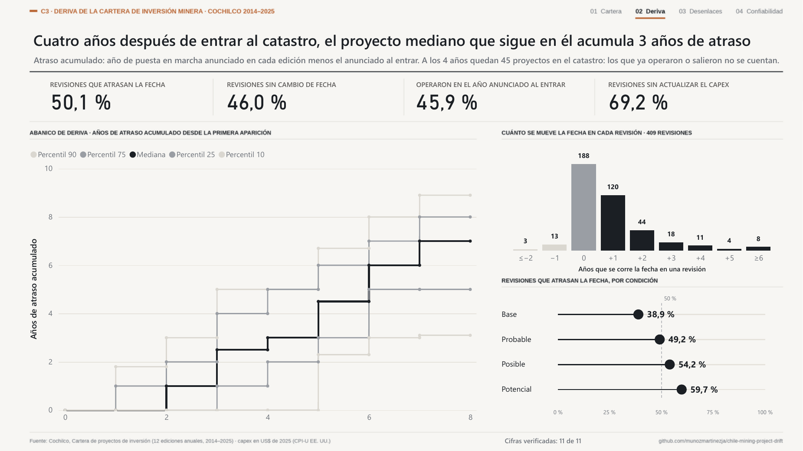
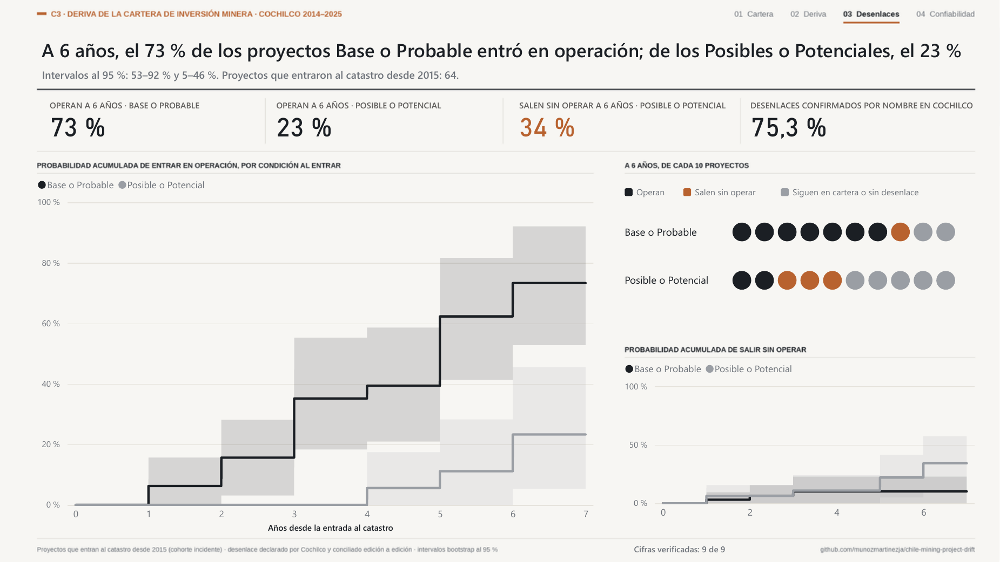
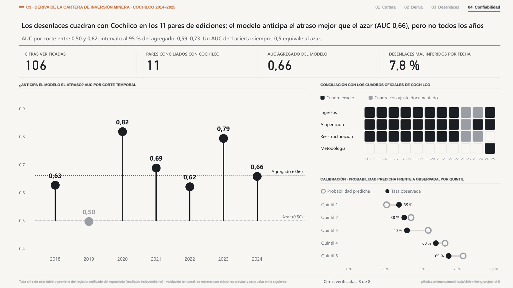

<!-- Generado desde docs/plantillas con cpdrift.publicacion. No editar a mano. -->
# Deriva de la cartera de inversión minera en Chile (2014–2025)

¿Cuánto se atrasan los proyectos mineros que anuncia la cartera de Cochilco y cuáles llegan a operar? Este repositorio sigue a 133 proyectos a lo largo de 12 ediciones anuales del catastro de inversión minera (2014–2025) y mide su deriva de plazo y de capex y su desenlace.

*English summary below.*



## Hallazgos principales

1. **La condición que asigna Cochilco separa a los proyectos que llegan a operar.** Entre los proyectos que entraron al catastro desde 2015 (n = 64), a 6 años entró en operación el 73 % de los Base o Probable (IC 95 %: 53 %–92 %) frente al 23 % de los Posible o Potencial (5 %–46 %). La brecha se mantiene en los 7 escenarios de sensibilidad.
2. **La fecha anunciada se corre.** El 50,1 % de las 409 revisiones entre ediciones atrasa la puesta en marcha. A los 4 años de entrar al catastro, el proyecto mediano que sigue en él acumula 3 años de atraso. Solo el 46 % de los proyectos que operaron lo hizo en el año anunciado al entrar.
3. **El modelo ordena el riesgo de atraso mejor que el azar, pero no en todos los años.** Con validación temporal (7 cortes), el AUC agregado es 0,66 (IC 95 %: 0,59–0,73) y varía entre 0,50 y 0,82 según el año. La mejora en probabilidades frente a la tasa base no es concluyente: su intervalo incluye el cero.

Todas las cifras de este repositorio provienen de un registro de 111 cifras recalculadas por código independiente ([`docs/registro_cifras.csv`](docs/registro_cifras.csv)). Los resultados son asociativos, no causales.

## Documentos

- [Brief](docs/brief.md): el estudio en una línea, en lenguaje simple y en su capa técnica.
- [Método](docs/metodo.md): fuentes, identidad de proyectos, conciliación con Cochilco, modelos, validación y limitaciones.
- [Preguntas difíciles](docs/preguntas_dificiles.md): las objeciones más fuertes al estudio y lo que el repositorio permite responder.

## Tablero

Cuatro páginas en Power BI: cartera, deriva, desenlaces y confiabilidad.

| | |
|---|---|
|  |  |
|  |  |

## Cómo reproducir

Requiere Python 3.12 y [uv](https://docs.astral.sh/uv/).

```bash
uv sync
uv run python -m cpdrift.fuentes      # descarga las fuentes y verifica su SHA-256
uv run python -m cpdrift              # pipeline completo y registro verificado
uv run python -m cpdrift.publicacion  # regenera README y documentos desde el registro
uv run pytest -q
```

Los informes de Cochilco se descargan desde sus URL públicas, listadas en [`data/reference/fuentes_raw.csv`](data/reference/fuentes_raw.csv). La planilla de precios del Banco Mundial (Pink Sheet) se actualiza cada mes: si su hash difiere, el pipeline avisa y continúa.

## Estructura

| Ruta | Contenido |
|---|---|
| `src/cpdrift/` | Extracción, identidad, conciliación, indicadores, modelos, verificación y publicación |
| `data/reference/` | Tablas curadas con cita a página: transcripción 2022, egresos declarados, cruce manual, ajustes, regiones y manifiesto de fuentes |
| `docs/` | Brief, método, preguntas difíciles, registro de cifras y capturas del tablero |
| `tests/` | Pruebas unitarias y de higiene |

## Fuentes y licencia

Datos: Comisión Chilena del Cobre (Cochilco), *Inversión en la minería chilena — Cartera de proyectos*, ediciones 2014 a 2025; Banco Mundial, *Commodity Price Data (Pink Sheet)*; U.S. Bureau of Labor Statistics, CPI-U. Los documentos fuente no se redistribuyen. El código se publica bajo licencia MIT (ver [`LICENSE`](LICENSE)).

---

## English summary

This repository follows 133 mining projects across 12 annual editions (2014–2025) of the investment portfolio published by Cochilco, Chile's copper commission, and measures schedule drift, capex drift and outcomes.

- **Cochilco's assigned condition separates projects that reach operation.** For projects entering the portfolio from 2015 onwards (n = 64), 73% of Base or Probable projects were in operation after 6 years (95% CI 53%–92%), against 23% of Possible or Potential projects (5%–46%). The gap holds in all 7 sensitivity scenarios.
- **Announced start-up dates slip.** 50.1% of 409 edition-to-edition revisions delay the start-up year. Four years after entry, the median project still in the portfolio has accumulated 3 years of delay.
- **A temporally validated model ranks delay risk better than chance, but not every year:** pooled AUC 0.66 (95% CI 0.59–0.73), 0.50 to 0.82 across 7 cuts. The improvement in probability accuracy over the base rate is not conclusive.

Every figure comes from a register of 111 independently recalculated figures. Results are associative, not causal. Documentation is in Spanish.
